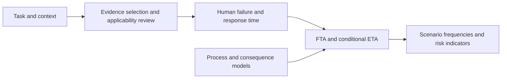

# Human Reliability Toolkit

**Composable Python models for human error, task performance and process-risk analysis.**

Version **0.4.0** adds licensed measurement/incident source metadata, three newly
acquired source families and six executed retrospective studies. The
[field validation record](docs/FIELD_VALIDATION.md) includes favorable, unfavorable
and withheld results. Process prediction accuracy and incident-case composition
remain separate from human error probability validation.

The operational layer includes twelve connected modeling capabilities:
executable actions, causal graphs, risk orchestration, communication/permits,
observed opportunities, intervention comparison, coupled dynamics, progress/deadline
checks, diagnostic information, sparse-data calibration, procedure/assurance
lifecycle and reviewed reference workflows. See the
[operational guide](docs/OPERATIONAL_EXTENSIONS.md) and
[acceptance evidence](docs/EXTENSION_VALIDATION.md).

The packaged, searchable human-performance evidence catalog remains available.
Inspect observed counts, select method references, document applicability, estimate
probabilities and connect results to FTA, ETA or existing process models. The core
works offline and needs only NumPy, SciPy and Pydantic. Coupled event scheduling
uses the optional SimPy extra.

**Software: MIT. External numeric evidence: source-specific terms.** Read
[DATA_LICENSES.md](DATA_LICENSES.md) before redistributing the catalog.

## Capabilities

| Capability | Included behavior |
|---|---|
| Task analysis | Task DAGs, executable unit-checked actions, error variants, permissives, roles and reviews |
| Evidence | **1,334 records from 7 numeric sources**, exact context filters, source locators, rights and explicit applicability reviews |
| Estimation | Observed-count Bayesian updates, supplied estimates, cognitive-stage decomposition and custom Python estimators |
| Method references | SPAR-H profiles; HEART task/EPC references; CREAM nominals/ranges; IDHEAS-ECA components, modifiers and arithmetic |
| Time and recovery | Censored response models, optional AFT/Cox regression, deadlines, recovery and conditional dependency |
| Risk | Repeated-event-safe FTA, optional BDD, conditional ETA, small Bayesian networks, LOPA screening and frequency/risk accounting |
| Dynamics | Closed-loop process interface, role-visible decisions, preemption, explicit retries, finite progress/deadline checks, optional SimPy and CoolProp |
| Operational research | Message/readback and work-permit states, opportunity/recovery ledgers, interventions, finite-grid partial pooling, elicitation and assurance snapshots |
| Empirical evaluation | Cross-year turbine estimates, rolling steel-energy forecasts, matched-condition distillation monitoring, CoolProp water checks, coded incident cases and simulator-context holdouts |
| Integration | PRISM, DynaSense, station safety logic, monitoring, LH2DT, SAGA, QSafety and PSA trace boundaries |

The catalog is **not 1,334 independent measurements or complete HEPs**:

| Record category | Count | Meaning |
|---|---:|---|
| Observed context-group counts | 578 | SACADA simulator UNSAT and opportunity counts |
| Method point probabilities | 176 | Nominal references or expert/model case outputs |
| Method probability intervals | 4 | CREAM control-mode ranges; no automatic midpoint |
| Base probability components | 96 | Method inputs, not stand-alone HEPs |
| Multipliers | 476 | Dimensionless factors, including explicitly marked placeholders |
| Terminal rules | 4 | SPAR-H certain-failure conditions |

There are **no acquired situation-specific observed annual human-error frequency
series and no chemical-plant field HEP calibration**. Calendar frequency requires
documented, compatible exposure supplied by the application.

## Install and run

Requires Python **3.12 or newer**:

```console
git clone https://github.com/lyullee/human-reliability-toolkit.git
cd human-reliability-toolkit
python -m venv .venv
```

Activate with `.venv\Scripts\Activate.ps1` on Windows PowerShell or
`source .venv/bin/activate` on Linux/macOS, then install:

```console
# Core API, CLI and bundled evidence; no source downloads required.
python -m pip install -e .

# All optional research and development capabilities.
python -m pip install -e ".[data,learning,survival,thermo,sensitivity,bdd,dynamics,curation,dev]"
```

```console
human-reliability doctor
human-reliability evidence summary
human-reliability field-sources
human-reliability evidence search --kind observed_count --function action --condition workload=2 --limit 3
human-reliability evidence show sacada.action.r0003
human-reliability template case.json
human-reliability run case.json --out result.json
python examples/evidence_to_risk.py
```

The template contains assumed values. The evidence example uses real released
counts, an explicit prior and assumed process/exposure inputs. It demonstrates
integration and does not validate a plant HEP.

## Observed evidence in Python

```python
from human_reliability import (
    ApplicabilityReview, BetaPrior, HumanFailureEvent, builtin_evidence_catalog,
)

catalog = builtin_evidence_catalog()
rows = catalog.search(
    kind="observed_count", function="action",
    conditions={"workload": 2, "time_criticality": 2},
)
print(len(rows))  # Candidates, not automatically applicable estimates.

event = HumanFailureEvent(
    id="response_failure", task_id="shutdown", step_ids=("operate",),
    role="response",
    failure_definition="Unsatisfactory response under the reviewed task definition",
    opportunity_definition="One reviewed manual-response demand",
    conditioning="Specified context, conditional on an automatic failure",
)
binding = catalog.bind(
    "sacada.action.r0003", event,
    prior=BetaPrior(alpha=0.5, beta=0.5, evidence_id="explicit_example_prior"),
    review=ApplicabilityReview(
        analyst="Example analyst", target_domain="illustrative_process_model",
        rationale="Software demonstration; simulator-to-plant transfer is not qualified.",
        scope_rationale="Aggregate UNSAT cannot separate timing/recovery; prevent either being applied twice.",
        included_effects=("timing", "recovery"),
    ),
)
print(binding.estimate.probability)
print(binding.estimate.status)  # research: explicit transfer to another domain
```

This group has **1 UNSAT in 103 opportunities**. The observed fraction is `1/103`.
The explicitly selected Beta(0.5, 0.5) prior gives posterior mean
`1.5/104 ≈ 0.0144231`. These are different quantities. Original counts, context,
prior, scope review and source license remain traceable. See the
[detailed evidence guide](docs/HUMAN_ERROR_DATA.md).

## From human performance to risk



Human error can initiate an event, leave a latent defect or defeat a response
barrier. Define its role before quantifying it. Task-error frequency needs matching
demand exposure; scenario harm additionally needs consequence and exposure models.
Preserve shared causes and avoid counting the same error, recovery, timing effect
or demand twice.

The [evidence-to-risk example](examples/evidence_to_risk.py) keeps its manual-demand
exposure consistent with its ETA. The [integration guide](docs/INTEGRATION.md)
distinguishes actual tested objects from receiving application work, including
PRISM's task-origin initiating-event extension.

## Operational cases

For a ready-to-edit operational case:

```console
human-reliability risk-template risk.json
human-reliability risk-run risk.json --out risk-result.json
human-reliability workflow-template method.json
human-reliability workflow-run method.json --out method-result.json
human-reliability coupled-template operations.json
human-reliability coupled-run operations.json --out operations-result.json
python examples/operational_research.py
```

The coupled runner requires `[dynamics]`. Templates use authored assumptions.
The Python example combines real released count evidence with an explicitly
illustrative causal/risk model, then demonstrates the twelve extensions.
Intervention assumptions remain assumptions; hidden simulation outcomes are not
exposed as operator observations. Timed verification uses an explicit finite serial
time grid. Complete IDHEAS/extended CREAM systems and plant field calibration are
outside those numerical workflow claims. Details are in the operational guide.

## Evidence limits

SACADA concerns licensed operators in **nuclear training simulators**. Its released
functions have 61 alarm, 95 indicator, 116 understanding, 147 decision and 159 action
context groups. Function opportunities sum to 18,096; this is not a verified count
of independent people, episodes or trials. The counts do not separate timing and
recovery or provide calendar exposure.

Published method outputs remain separate from observations. IDHEAS values of
1.1/1.2 remain source placeholders. A reversed published HEART interval is withheld.
The [review registry](research/human_evidence_review.json) records 18 candidates,
including exclusions for restrictive terms, absent denominators and engineered
errors. No unrestricted raw HuREX/CORE-DATA/HERA release is claimed.

Nine earlier process/context data families, about 1.705 GB locally, remain available
through separate acquisition scripts. Equipment fault labels do not become human
labels. See [process/context data](docs/DATA.md).

## Reproduce and verify

The bundled catalog is immediately usable. To independently inspect/rebuild it:

```console
python scripts/acquire_human_evidence.py
# If automated downloads are rejected, download normally from the official pages:
python scripts/acquire_human_evidence.py --import-directory artifacts/incoming
python scripts/curate_human_evidence.py
python examples/evidence_to_risk.py
python scripts/run_verification.py
python scripts/inventory_environment.py
python scripts/build_release.py
```

The curator requires `[data,curation]`. SHA-256 checks pin the source assets. Raw
sources are excluded from Git and distribution archives. Verification covers
Python, packaged numeric JSON and relevant configuration. Build preparation rejects
changed inputs; archive inspection and an isolated core-wheel install check the
distribution boundary and installed behavior.

## Documentation

| Document | Purpose |
|---|---|
| [User guide](docs/USER_GUIDE.md) | Installation, task/event design and risk workflow |
| [Operational extensions](docs/OPERATIONAL_EXTENSIONS.md) | Twelve capabilities, parameters, Python/CLI workflows and limits |
| [Extension validation](docs/EXTENSION_VALIDATION.md) | Acceptance cases, regression evidence and retained design decisions |
| [Human-error data](docs/HUMAN_ERROR_DATA.md) | Provenance, codebook, selection, APIs and reproduction |
| [API](docs/API.md) | Contracts, custom estimators and composition |
| [Methods](docs/METHODS.md) | Mathematics, assumptions and method scope |
| [Architecture](docs/ARCHITECTURE.md) | Module boundaries and design decisions |
| [Integration](docs/INTEGRATION.md) | Existing projects and checked boundaries |
| [Validation](docs/VALIDATION.md) | Software/empirical checks and qualification limits |
| [Development log](docs/DEVELOPMENT_LOG.md) | Decisions and corrected errors |
| [Developer handbook](docs/DEVELOPER_HANDBOOK.md) | Adding data, models and adapters |
| [Research handoff](docs/RESEARCH_HANDOFF.md) | Continue without session history |
| [Data licenses](DATA_LICENSES.md) | Attribution and reuse conditions |
| [Reuse policy](docs/LICENSING.md) | Source boundary and publication checks |

Machine-readable provenance and results live in `research/`. Start with
`human_evidence_audit.json` and `verification_summary.json` there.

This is research software. Field transfer, task validity, physical models and
protection credit require evidence beyond passing software tests. Read the
applicable assumptions before interpreting a numerical result.
