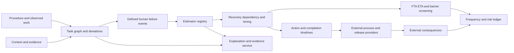

# Architecture and model boundaries

Version 0.2.0 adds typed source/rights records, numeric records linked by source ID
and a SACADA categorical codebook. Bundled JSON uses core dependencies; optional
source readers do not execute during ordinary catalog queries. Numeric profiles
retain the distinction between observations, complete probabilities, components,
modifiers and placeholders.

Binding evidence requires domain/scope review and preserves source and target
definitions separately. Exposure conversion checks the target demand definition
and labels its output as derived. The engine can receive a custom catalog and
uses its existing evidence/result guard for catalog estimates.

The library separates task meaning, evidence, probability calculation, temporal
behavior, physical consequences and risk aggregation. Each layer has a different
observation unit. A monitoring alarm, a task demand, a wrong command, a failed
actuator and a harmful consequence must not share one undifferentiated label.

## Data flow

`contracts` defines strict Pydantic records and canonical JSON hashing. Frozen
models prevent field reassignment but nested dictionaries are not deeply immutable;
applications should construct a new case for a changed assessment and recompute its
digest. JSON versions are checked before evaluation. Python constructors use strict
container types; JSON readers use `model_validate_json`.

## Calculation ownership

The core owns probability arithmetic and checks. A method adapter owns the mapping
from assessed context to coefficients. The caller owns data eligibility and the
failure/opportunity definition. External process models own mass, energy, inventory,
release geometry and actuator dynamics. Consequence models own exposure and harm.
PRISM or another risk application owns initiating-frequency assembly and facility
aggregation. SAGA owns retrieval and prose generation; it is not a numeric oracle.

The supplied cognitive chain is a sequence of first-failure probabilities conditioned
on preceding stages succeeding. Its product of conditional successes does not
assert marginal independence. A scenario mixture requires exclusive contextual
weights summing to one. A Bayesian network can model shared causes explicitly.

## Timing and simulation

`simulate_task` schedules a task DAG with role capacities. Failure callbacks receive
only outcomes completed before the current start time. Callback consequence replay
is ordered by completion after the episode has been scheduled. It is an open-loop
event generator, not a synchronized closed-loop cognitive/plant co-simulator.
External feedback that changes future human decisions requires an application
scheduler or a future coupled runtime.

Deadlines are absolute episode seconds. Completion-time distributions apply only
under their declared failure conditioning. A terminal wrong action cannot be made
into an ordinary right-censored success time. Unidentified survival tails remain
unavailable in the nonparametric model.

## Boolean and temporal logic

Fault-tree event identity is preserved by exact state enumeration or the optional
`dd.autoref` BDD backend. These evaluate a static Boolean expression over distinct
events. Chronology is represented by task/timeline and workflow models. No ordered
dynamic gate is silently approximated by a static AND.

`WorkflowNet` explores token markings under explicit transitions and capacities.
An exhaustive finite search can pass a specified property. A reached state limit
produces an incomplete result. Neither result proves omitted real-world transitions
safe. `SafetyCase` records support dependencies and propagates changed evidence
through claims; it does not automatically certify those claims.

## Extension points

- Add `DeviationRule` records or replace the JSON case's rule tuple.
- Register an `Estimator` accepting `MethodInput` and returning `Estimate`.
- Supply any `TimeModel` with `cdf` and `sample` under consistent semantics.
- Supply conditional probability tables or an external inference implementation.
- Consume action outcomes through a consequence replay callback.
- Use object factories in adapters to validate against an external project's types.
- Keep source licenses and units in the application-owned evidence registry.

Imported models and schemas are pinned in integration checks. No external source
is shipped inside the package. Optional services retain separate dependency
environments when their numerical/native requirements conflict.
